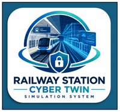
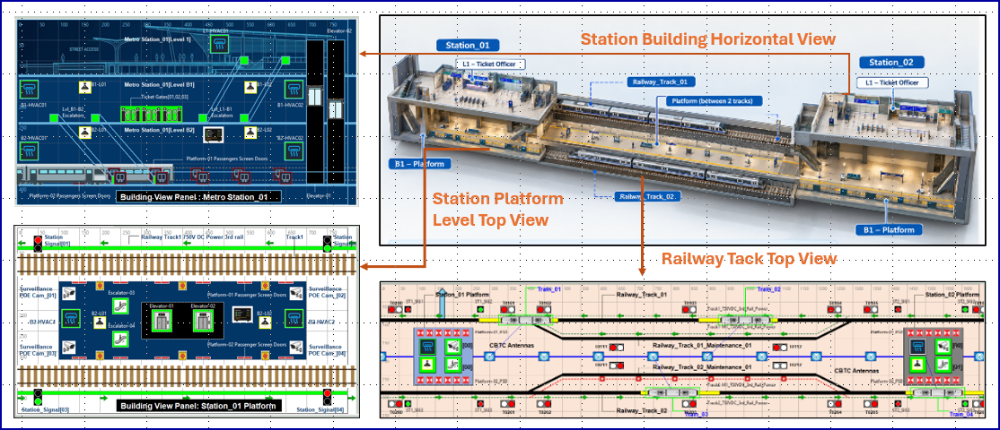
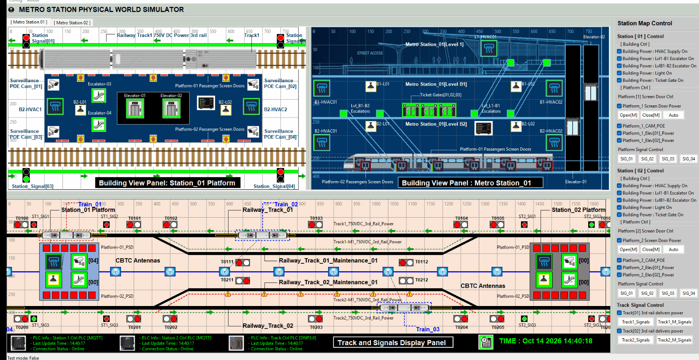
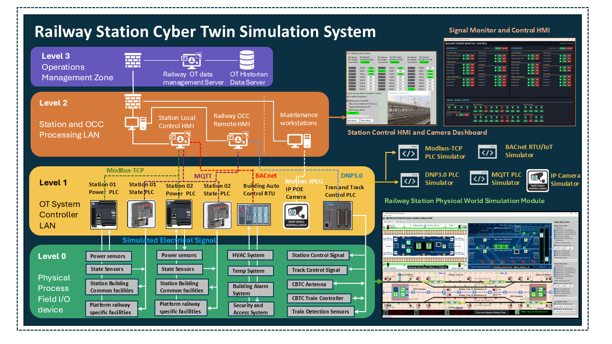

# Metro_Railway_Station_CyberTwin_System_Document

**Project Design Purpose** : The Railway Station Cyber Twin Simulation System is a software-based Operational Technology simulation platform designed to address OT cybersecurity challenges in two critical infrastructure sectors:  public transportation and CI building management. The platform integrates three SCADA systems: the Communication-Based Train Control (CBTC) signalling system, the Station Building Management System (BMS), and the Railway Platform Management System. Designed according to the ISA-95/IEC-62264  industrial automation architecture, the cyber twin models OT environments from Level 0 to Level 3 to represent the interactions between physical processes, control systems, station operations, and enterprise-level management. It provides a realistic and controlled environment for investigating potential OT cyber threats, evaluating their impact on railway operations, and supporting cybersecurity testing, training, and cyber exercises.



```python
# Author:      Yuancheng Liu
# Created:     2026/10/14
# Version:     v_0.0.1
# Copyright:   Copyright (c) 2026 Liu Yuancheng
# License:     GNU General Public License V3
```

**Table of Contents** 

[TOC]

### 1. Project Introduction

The Railway Station Cyber Twin System is a software-based OT simulation platform designed to model the operations of two nearly metro railway stations and the railway tracks connecting them. The system integrates railway signalling, train control, station building automation and platform management into a unified cyber twin environment. Developed for cybersecurity exercises, technical training, security research, and educational purposes, the platform provides a realistic and interactive representation of metro railway infrastructure and its associated Supervisory Control and Data Acquisition (SCADA) systems.

The cyber twin models four key subsystems relevant to metro OCC operations and station management: the Railway Station Building Management System, Railway Platform Management System, Railway Track and Signalling System, and Moving Block Train Control System. A simple mapping view between physical railway infrastructure and the corresponding cyber twin simulation components is shown below: 



#### 1.1 Cyber Twin System Overview

**1.1.1 Four Main SCADA Subsystems**

The Metro Railway Station Cyber Twin System comprises four major SCADA subsystems : 

- **Station Building Management System** : Simulates two underground metro stations with the both the common building automation equipment (such as lighting, HVAC, elevators...) and the railway-specific facilities (such as ticket gates, station ventilation systems, and various alarm systems).
- **Station Platform Management System** : Models platform-level equipment and passenger management functions at both stations such as automatically controlled platform screen doors, train detection sensors, surveillance cameras, people-counting radar,broadcast systems and the tunnel ventilation system.
- **Railway Track and Signalling System** : Simulates four railway tracks ( 2 direct connect with 2 maintenance) connecting the two stations, together with a 750 V DC third-rail traction power supply system, track-fork-switch control, railway signalling equipment, and trackside train detection sensors.
- **Communication-Based Train Control (CBTC) System** : Simulates multiple trains operating between the two stations according to train schedule, track conditions and signalling information.  For trains sharing the same track, a simplified simulated CBTC model supports automatic speed adjustment, trains movement coordination, and automatic train protection.

**1.1.2 Cyber Twin Interface View**

The system physical world simulation UI provides a visual representation of railway stations, tracks, trains, and associated infrastructure components as shown below:



The interface enables users to observe simulated system states and understand the operational effects of changes to individual components and interconnected subsystems. For detail system demonstration, refer to the video: 

**1.1.3 System OT Communication Protocols **

To support realistic interactions between the simulated infrastructure components, the platform incorporates the PLC/RTU simulators I developed and four industrial OT communication protocols:

- **Modbus TCP (IEC 61158):** Supports communication for power control and related OT components.
- **BACnet (ISO 16484-5):** Supports building automation and the collection of building sensor data.
- **MQTT (ISO/IEC 20922):** Supports the exchange of platform and railway track status information and control messages.
- **DNP3 (IEEE 1815-2021):** Supports communication within the simulated auto train control and CBTC schedule system.

For the PLC and RTU simulator module, please refer to this project: https://github.com/LiuYuancheng/PLC_and_RTU_Simulator

#### 1.2 Design Objectives and Intended Use Cases

The system adopts a layered OT architecture covering **ISA-95 Levels 0 to 3**, representing physical processes, basic control, supervisory control, and manufacturing or operational management functions, as applicable to the simulated railway environment as shown below:



Its primary design objectives and use cases are as follows:

- **Demonstrate the operational impact of OT cyber threats:** Provide a controlled environment to investigate how attacks against individual PLCs, RTUs, communication protocols, or SCADA subsystems could disrupt railway operations, compromise station services, or propagate across interconnected infrastructure systems.
- **Support cybersecurity exercises and professional training:** Enable railway operators, cybersecurity practitioners, researchers, and students to practise threat analysis, attack detection, incident response, and recovery in a simulated metro railway environment.
- **Facilitate cross-domain OT security analysis:** Demonstrate the dependencies among train control, railway signalling, station building automation, platform management, and supporting infrastructure, highlighting how incidents in one subsystem may affect other operational domains.
- **Provide a cost-effective and scalable simulation platform:** Offer a software-based alternative to physical OT testbeds that can be deployed in laboratories, academic institutions, and cyber exercise environments without requiring a complete physical railway infrastructure.
- **Support OT security research and education:** Provide a repeatable and configurable platform for investigating SCADA security, industrial protocol behaviour, attack scenarios, defensive mechanisms, and the operational consequences of cyber incidents.


------

> last edit by LiuYuancheng (liu_yuan_cheng@hotmail.com) by 22/10/2026 if you have any problem, please send me a message. 